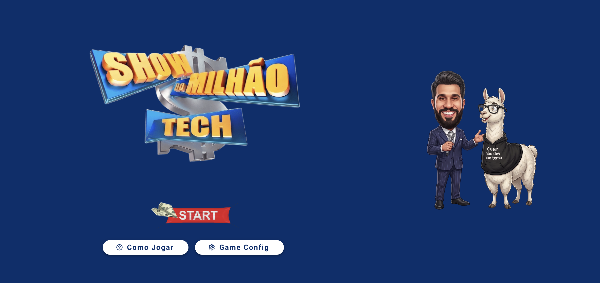

# 💰 Show do Milhão - AI Edition

<p align="center">
  <br><br>
  <b>Jogo de perguntas e respostas dinâmico integrado à Inteligência Artificial (Llama 3 via Ollama)</b>
</p>

<p align="center">
  
  
  
  
</p>

---

## 🎯 Sobre o Projeto

Uma releitura do clássico jogo **Show do Milhão**, focada em perguntas técnicas sobre **Desenvolvimento Web**, **UI/UX** e **CRO (Otimização de Conversão)**. 

Diferente das versões com banco de dados estático, este projeto consome a **LLM local Llama 3 (via Ollama)** para gerar perguntas, alternativas e gabaritos inéditos em formato JSON a cada nova partida.

O jogo conta com dois modos de partida: o modo **Clássico** (single player) e o modo **PlayOffs**, um modo competitivo 1x1 com sistema de turnos, apostas e eliminação.

---

## 🚀 Tecnologias Utilizadas

* **[Vue.js](https://vuejs.org/):** Framework Javascript para a interface.
* **[Vuex](https://vuex.vuejs.org/):** Gerenciamento de estado centralizado do jogo.
* **[Vuetify](https://vuetifyjs.com/):** Biblioteca de componentes UI baseada em Material Design.
* **[Ollama](https://ollama.com/):** Execução local de modelos de Inteligência Artificial.
* **[Llama 3](https://ai.meta.com/llama/):** Modelo de linguagem responsável por criar as perguntas dinamicamente.
* **[Swiper.js](https://swiperjs.com/) (v8):** Carrossel automático da tela de instruções (compatível com Vue 2).

---

## ✨ Funcionalidades

- **Perguntas Dinâmicas com IA:** Geração sem necessidade de APIs pagas ou chaves de acesso.
- **Curva de Dificuldade Progressiva (Porcentagem):** A complexidade das perguntas é calculada automaticamente com base no total de perguntas da partida:
  - 0% a 50%: Nível Fácil (conceitos fundamentais e definições).
  - 50% a 80%: Nível Médio (boas práticas e cenários práticos intermediários).
  - 80% a 100%: Nível Difícil/Especialista (arquitetura avançada, diagnósticos em produção e trade-offs críticos).
- **Cartas:** Modal com 4 naipes de baralho (com valores de 1 a 4 sorteados aleatoriamente a cada partida) que elimina a quantidade correspondente de alternativas incorretas.
- **IA:** Exibe a resposta correta por extenso gerada pela IA. Fica automaticamente desabilitado na última pergunta (Pergunta do Milhão).
- **Universitários:** Solicita que o jogador peça ajuda de amigos para achar a resposta certa.
- **Tela "Como Jogar":** Carrossel automático com as regras dos modos de jogo, das ajudas, do Truco e da pontuação (veja a seção [Tela de Instruções](#-tela-de-instruções-gameinstructions)).

---

### 🏆 Modo PlayOffs

Modo competitivo para 2 jogadores, disputado por turnos na mesma partida. As regras a seguir se aplicam **exclusivamente** a esse modo de jogo.

#### Regras Gerais

- O **Jogador 1** inicia a partida e permanece jogando sozinho, sequencialmente, **enquanto for acertando** as perguntas (+5 pontos por acerto).
- Ao **errar uma alternativa** ou **clicar em "Desistir"**, o jogador atual sofre sua primeira falha:
  - Se o **outro jogador nunca jogou** durante toda a partida, a vez é passada para ele, que assume o controle a partir da **próxima pergunta**.
  - Se o **outro jogador já jogou alguma vez** e o jogador atual falha novamente (2ª falha, seja erro ou desistência), a partida é **encerrada imediatamente**, redirecionando para a tela de **Fim de Jogo**.
- Cada jogador possui, portanto, **apenas 1 falha permitida durante toda a partida** (erro ou desistência).

#### Botão "Desistir"

Disponível apenas no modo PlayOffs. Permite ao jogador ativo encerrar seu turno voluntariamente, mantendo o placar atual **sem penalidades de pontuação**. Segue a mesma regra de "1 falha por jogador" descrita acima: se o outro jogador já tiver jogado, a partida é encerrada.

#### Botão "Truco"

Ajuda de **uso único por jogador** (assim como Cartas, IA e Universitários), disponível apenas no modo PlayOffs. Ao ser acionado, abre um modal de aposta com duas opções:

- **Aceitar:** o jogador ativo responde a pergunta atual com risco/prêmio dobrado:
  - Se **acertar**: ganha **10 pontos** (em vez de 5).
  - Se **errar**: perde a metade dos pontos atuais **e mais 10 pontos** do saldo restante, seguindo a mesma regra de troca de turno / fim de jogo do erro comum.
- **Dobrar a Aposta:** o jogador ativo encerra seu turno **sem responder** a pergunta atual, mantendo sua pontuação intacta. A vez passa para o **outro jogador**, que responderá **a mesma pergunta** (sem avançar de rota) sob risco/prêmio dobrado:
  - Se **acertar**: ganha **10 pontos**.
  - Se **errar**: perde **20 pontos** fixos, seguindo a mesma regra de troca de turno / fim de jogo do erro comum.
  - O efeito da aposta dobrada é válido **somente para essa pergunta específica**, não persistindo para as perguntas seguintes.

#### Botão "Pulo"

Disponível **apenas no modo Corrida do Milhão** (Clássico). No modo PlayOffs o botão **não é exibido**. Permite ao jogador pular a pergunta atual e avançar diretamente para a próxima, **sem sofrer qualquer penalidade de pontuação**.

- Cada jogador possui direito a **até 3 pulos por partida**.
- No modo **PlayOffs**, o contador de pulos é **individual por jogador** e é **reiniciado automaticamente** ao final do turno (erro, desistência ou Truco dobrado), voltando a 3 pulos disponíveis quando o jogador assumir o controle novamente.
- No modo **Corrida do Milhão**, o contador é único durante toda a partida, já que não há troca de turnos.
- Os dados de uso são armazenados em cache (`localStorage`) e **limpos automaticamente**:
  - Ao final do turno do jogador (apenas no modo PlayOffs);
  - Ao final da partida (vitória ou Game Over), em ambos os modos.
- O botão é **desabilitado automaticamente** conforme a proximidade do fim da partida, para evitar que o jogador finalize o jogo sem responder a nenhuma pergunta:
  - **Faltando 3 perguntas** para o fim: desabilitado caso o jogador ainda possua os **3 pulos** disponíveis.
  - **Faltando 2 perguntas** para o fim: desabilitado caso o jogador ainda possua **2 ou 3 pulos** disponíveis.
  - **Na última pergunta** (Pergunta do Milhão): **sempre desabilitado**, independentemente da quantidade de pulos restantes.

---

### 📖 Tela de Instruções (GameInstructions)

Tela acessível pelo botão **"Como Jogar"** na Home (rota `/instructions`), que explica as regras do jogo em um carrossel de cards de **500x500px**, no mesmo padrão visual das demais telas.

#### Comportamento do carrossel

- **Autoplay:** avança para o próximo card a cada **6 segundos**, em loop infinito.
- **Controles:** abaixo do card, um wrapper com seta para a esquerda (`chevron-left`), botão de **pausa/reprodução** no centro e seta para a direita (`chevron-right`).
- **Indicadores:** pontos clicáveis mostram a posição atual.
- **Interação:** clicar nas setas ou nos pontos **não interrompe** o autoplay. Só o botão de pausa o interrompe.
- **Acessibilidade:** navegação por teclado (setas) e `aria-label` nos controles.
- **Botão "Entendi":** retorna para a tela anterior.

#### Cards

| # | Card | Conteúdo |
|---|------|----------|
| 1 | Modos de Jogo | Apresenta os modos "Playoffs" e "Corrida do Milhão" |
| 2 | Playoffs | Batalha entre 2 jogadores por pontos |
| 3 | Corrida do Milhão | Modo clássico single player com prêmio de R$ 1 milhão |
| 4 | As Ajudas | Visão geral das ajudas e da regra de uso único |
| 5 | Cartas | Elimina alternativas erradas ao escolher um naipe |
| 6 | IA | Revela a alternativa correta |
| 7 | Universitários | Ajuda dos colegas |
| 8 | Pulo | Pula a pergunta sem ganhar nem perder pontos |
| 9 | Truco (Playoffs) | Regras da aposta, exclusiva do PlayOffs |
| 10 | Desistir | Passa a vez sem perder pontos |
| 11 | Pontuação nos Playoffs | Pontos por acerto e por erro |

#### Textos e configurações

Os textos ficam centralizados em `src/constants/uiTexts.js` (chaves `INSTRUCTIONS_*`). Os valores numéricos usam placeholders ligados ao `PLAYOFFS_SCORING` (`src/constants/game.js`), então alterar a pontuação atualiza os cards automaticamente:

| Placeholder | Constante |
|-------------|-----------|
| `{normal_win}` | `NORMAL_WIN_POINTS` |
| `{truco_simple_win}` | `TRUCO_SIMPLE_WIN_POINTS` |
| `{truco_double_win}` | `TRUCO_DOUBLE_WIN_POINTS` |
| `{truco_simple_penalty}` | `TRUCO_SIMPLE_ERROR_PENALTY` |
| `{truco_doubled_penalty}` | `TRUCO_DOUBLED_ERROR_PENALTY` |

O tempo do autoplay e da transição são configurados em `INSTRUCTIONS_CONFIG`:

```javascript
export const INSTRUCTIONS_CONFIG = Object.freeze({
  AUTOPLAY_DELAY: 6000,    // ms entre um card e o próximo
  TRANSITION_SPEED: 500,   // ms da animação de troca
});
```

#### Estrutura de arquivos

```
src/
├── constants/
│   ├── game.js              # INSTRUCTIONS_CONFIG e PLAYOFFS_SCORING
│   └── uiTexts.js           # Textos INSTRUCTIONS_* e HOME_INSTRUCTIONS_BUTTON
└── views/
    └── GameInstructions/
        ├── GameInstructions.vue
        └── style.css
```

---

#### Tela de Fim de Jogo (Game Over)

Ao final da partida (por eliminação de ambos os jogadores), o usuário é redirecionado para uma tela de **ranking**, exibindo:
- Nome e pontuação final de cada jogador, ordenados do maior para o menor placar.
- Destaque visual (coroa) para o jogador vencedor, quando não há empate.
- Indicação visual (ícones de check/minus) de quais ajudas (Cartas, Universitários e Truco) cada jogador utilizou durante a partida.

---
## 🛠️ Como Executar o Projeto

### 1. Pré-requisitos (Configurar o Ollama)

1. Baixe e instale o **[Ollama](https://ollama.com/)**.
2. No terminal, baixe o modelo **Llama 3**:
   ```bash
   ollama pull llama3
   ````

3. Inicie o serviço do Ollama liberando o acesso CORS para a aplicação web:
    - macOS / Linux:
    ```bash 
        OLLAMA_ORIGINS="*" ollama serve
    ````

    - Windows (PowerShell):
    ```bash
        $env:OLLAMA_ORIGINS="*" ; ollama serve
    ````

### 2. Executando o Projeto Vue

1. Clone o repositório e instale as dependências:
    ```bash
        npm install
    ````

2. Inicie o servidor de desenvolvimento:
    ```bash
        npm run serve
    ```

3. Acesse no navegador http://localhost:8080

## Integração com a LLM
A comunicação com o Llama 3 ocorre por meio de chamadas HTTP POST enviadas para o endpoint local 
http://localhost:11434/api/generate utilizando retorno em JSON estrito:

```javascript
const response = await fetch("http://localhost:11434/api/generate", {
  method: "POST",
  headers: { "Content-Type": "application/json" },
  body: JSON.stringify({
    model: GAME_CONFIG.MODEL_NAME,
    format: "json",
    stream: false,
    options: {
      temperature: GAME_CONFIG.TEMPERATURE,
      num_ctx: 4096 // Janela de contexto estendida para garantir o retorno completo
    },
    prompt: GAME_CONFIG.GET_PROMPT(GAME_CONFIG.THEMES, GAME_CONFIG.TOTAL_QUESTIONS)
  })
});

const data = await response.json();
const iaJson = JSON.parse(data.response);
```

### Licença
Este projeto está sob a licença MIT. Veja o arquivo LICENSE para mais detalhes.

Originalmente Desenvolvido por Lucas Fioti
Adaptado por Nathan Parente